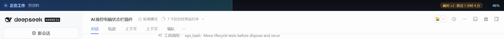

<p align="center">
  
</p>

# dsh-control-bar

模型开始直接操作你的电脑（点鼠标、敲键盘、跑命令）时，屏幕顶部常驻一条状态栏：
**正在操控** + 一句正在做什么 + 真实百分比进度，右侧还标出此刻是 **DeepSeek 峰时还是谷时**。

因为峰时单价是谷时的两倍，这个包同时带一条行为约束：**要烧大量 token 的操作，峰时先问你一句，谷时直接干。**

## 安装

在 DSH Desktop 里打开 **插件 → 插件市场**，搜索 `dsh-control-bar` 安装，重启应用。
命令行等价写法（`web`/`desktop` 换成你实际用的 profile）：

```sh
dsh plugin --profile desktop add dsh-control-bar
```

也可以直接从仓库装（没发 npm 时的等价写法，本包没有构建步骤，装完即用）：

```sh
dsh plugin --profile desktop add github:JianGuo396/dsh-control-bar
```

状态栏是一个独立 Electron 进程，不占用 DSH 自己的窗口。它在启动时按这个顺序找可用的
Electron：`overlay.electronPath` → `DSH_CONTROL_BAR_ELECTRON` → `DSH_ELECTRON_PATH` →
`$DSH_HOME/electron` → `~/.dsh/electron`（[dsh-pet](https://www.npmjs.com/package/dsh-pet)
装过 Electron 的话这里就有）。都找不到时状态栏不显示，插件其余功能照常工作，并在日志里
给出 `overlay not running (electron-not-found)`。

## 用法

装上之后不需要你要模型记得做什么——状态栏跟着 agent 的**回合**开合，和 codex 那条状态行一个逻辑：

| 宿主事件 | 状态栏 |
|---|---|
| `turn/start` | 自动亮起：「正在工作」+「正在处理你的请求」，4% |
| 每次 `tool/call` | 文案换成正在做的事（执行命令／读写文件／查资料／操作浏览器…），进度沿单调曲线前进 |
| `turn/end` / `agent/error` | 补到 100%「完成」，停 1.2 秒后自动收起 |

模型被中断、报错、忘了收尾，都不会留下一条挂着的进度条——这正是上一版的问题。
只用 `control_bar` 时它仍然可用（`start`/`update`/`finish`/`hide`），
用于模型直接操控界面时补一条更准确的中文进度。

也可以手动控制，或让脚本/其它 Agent 用：

```sh
dsh-control-bar 35 "正在打开浏览器搜索"   # 设置进度与文案
dsh-control-bar hide                     # 立刻收起
dsh-control-bar peek                     # 看当前峰谷与下次切换时间
dsh-control-bar overlay start|stop|status # 手动起停顶栏进程
```

## 峰谷口径

| | 时间（北京时间） | 单价 |
| --- | --- | --- |
| 峰时 | 周一至周五 09:00–12:00、14:00–18:00（UTC 01:00–04:00、06:00–10:00），法定节假日除外 | ×2 |
| 谷时 | 其余全部时间（含周末、法定节假日整天） | ×1 |

官方定价说明里「峰时 = UTC 01:00–04:00 与 06:00–10:00，周一至周五，排除中国法定节假日；
谷时单价为峰时一半」。本包把 2026 年国办放假安排内置成节假日表，判断时不依赖任何网络请求。
需要改口径就改配置里的 `pricing.windows` / `pricing.holidays`。

**守门规则**（写进系统提示，模型据此执行）：

- 峰时 + 预计 token 量很大（默认参考 20 万 tokens 量级）：先写一条进度
  `text:"峰时大额操作，等你确认"`，再用 `ask_user_question` 给出「现在就做 / 等谷时再做 /
  缩小范围」三选一，你点了才继续；
- 谷时：大额操作不为了省钱额外确认，直接做；
- 小操作（读几个文件、查一条命令、看一眼页面）任何时候都不问。

阈值与开关都在配置里；`peak_valley` 工具返回 `tokenThreshold` 与
`largeTokenNeedsConfirmation`，脚本也能据此判断。

## 配置

写进 profile 的 `cordis.patch.yml`（或用宿主提供的任意配置入口）：

```yaml
- id: dsh-control-bar
  name: dsh-control-bar
  config:
    overlay:
      enabled: true      # false = 不弹状态栏，只保留工具与峰谷判断
      height: 34         # 状态栏高度（DIP），18–120
      electronPath: ''   # 指定 Electron 可执行文件；留空自动探测
      staleMs: 300000    # 这么久没更新就当陈旧，自动收起
    pricing:
      timezone: Asia/Shanghai
      windows: '09:00-12:00,14:00-18:00'
      holidays: cn-2026  # cn-2026 | none | 2026-10-01,2026-10-02
    gate:
      enabled: true
      tokenThreshold: 200000
    dataDir: ''          # 默认 $DSH_HOME/control-bar
```

## 排障

- **屏幕上没有条**：看日志里的 `overlay not running (...)`。最常见是没找到 Electron，
  按上面的顺序装 dsh-pet 或写 `electronPath`；其次是 `overlay.enabled=false`。
- **条卡住不动**：状态文件半小时没更新会自己隐藏；`dsh-control-bar hide` 立刻收起。
- **多显示器**：默认只挂主屏顶部。状态文件在 `$DSH_HOME/control-bar/state.json`，
  `probe.json`（`DSH_CONTROL_BAR_PROBE=1` 时生成）里有真实几何，便于排查 DPI 问题。

## 隐私

不联网、不上报。状态栏只读本地 `state.json`（一个进度数字和一句话），渲染进程无 Node 权限、
无键盘焦点、鼠标事件穿透，不会挡住你正在操作的窗口。

## License

MIT
